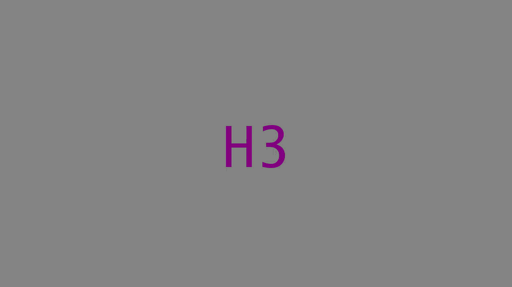

# **Letter-Digit Task**

### Task Configuration

The task included two trial types:

- **Switch trials:** The letter-digit pair changed colour from the previous trial, requiring participants to switch between the letter task (classifying letters as consonants or vowels) and the digit task (classifying digits as odd or even), or vice versa.
- **Repeat trials:** The pair retained the same colour, requiring participants to repeat the same task.

The task included three versions:

- **Control:** One switch trial presented midway through the task, between two randomly ordered sets of repeat trials (one for the letter task and one for the digit task). Fixed trial duration based on familiarisation.
- **Standard:** Equal numbers of switch and repeat trials (excluding the first trial). Fixed trial duration based on familiarisation.
- **Adaptive:** Equal numbers of switch and repeat trials (excluding the first trial). Trial duration was initially set based on familiarisation and adjusted for the subsequent trial based on performance on switch trials.

**Trial randomisation:** Trials were presented in random order, subject to the following constraints:

- The same letter-digit pair could not be presented on consecutive trials.
- No more than two consecutive letter or digit trials could share the same response key.
- Each response category (consonant, vowel, odd, and even) appeared in 25% of trials, with each letter and digit appearing in at least 5% of trials.
- **Standard and adaptive versions:** No more than two consecutive switch or repeat trials (i.e., a maximum of three consecutive letter or digit trials).
