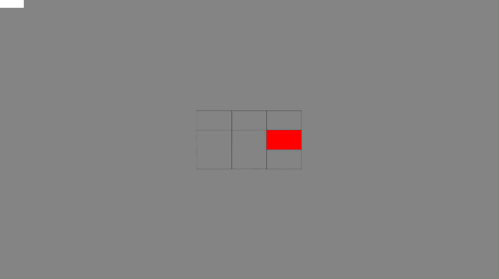

# **Spatial-Figural Updating Task**

### Task Configuration

The task included sets comprising two phases:

- **Memorisation phase:** A series of grids, each with one cell illuminated in a specific colour (blue, yellow, green, or red). Participants memorised and updated the most recently illuminated cell.
- **Recall phase:** A set of coloured grids, requiring participants to respond to the most recently illuminated cell of each colour.

The task included three versions:

- **Control:** Each colour was illuminated in the same memorisation cell and in a fixed order. Fixed memorisation trial duration based on familiarisation.
- **Standard:** Each colour was always illuminated in a unique cell. Fixed memorisation trial duration based on familiarisation.
- **Adaptive:** Each colour was always illuminated in a unique cell. Memorisation trial duration was initially set based on familiarisation and adjusted for the subsequent set based on performance in the recall phase.

**Trial randomisation:** Memorisation trials were presented in random order, subject to the following constraints:

- The same colour could not be illuminated twice in a row.
- Each of the three colours appeared at least twice but no more than five times per set.
